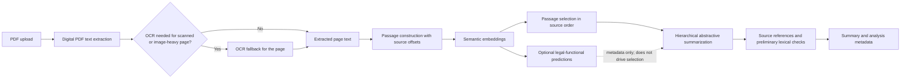

# NLP-Based Indian Legal Judgment Summarizer

### Make long judgments easier to navigate—and their sources easier to follow.

Indian court judgments can run for hundreds of pages. Their facts, arguments, legal questions, reasoning, and decisions matter to citizens, students, journalists, and researchers, but finding and understanding those parts can be difficult. This research prototype explores how NLP can turn a long judgment into a concise, structured, more accessible summary while retaining references to the source passages.

The goal is not simply to make judgments shorter. It is to help more people find out **what happened, what each side argued, what the court considered, how it reasoned, and what it decided**—and to make it easier to return to the original text.

> **Research prototype:** Summaries and analysis are experimental aids to reading, not substitutes for the judgment or legal advice.

## The Problem

Judgments combine different kinds of material: procedural history, party submissions, evidence, legal provisions, precedent, judicial analysis, and orders. These elements can be interwoven across a long document and expressed in dense legal language. A reader may have to work through many pages to locate the part relevant to a particular question.

Conventional summarization can shorten text but lose the relationships that make a legal account meaningful. A summary may blur a party's argument with the court's finding, omit qualifications or counterarguments, detach a conclusion from the reasoning that supports it, or lose the location of a statement in its source. In law, **who said what, in response to which issue, and with what result** is as important as brevity.

## Our Approach

The project combines a working document-processing and summarization backend with separate research experiments:

- **Represent the long document:** Split extracted judgment text into manageable, source-ordered passages while retaining character offsets.
- **Represent passages semantically:** Encode passages with sentence embeddings to support similarity analysis and exploratory structural signals.
- **Explore legal-functional categories:** An optional classifier can assign transferred RMU:ECHR functional predictions to passages. These are not verified Indian-law labels and do not determine passage selection.
- **Study passage relationships:** Compare semantic similarity, document proximity, and—within the RMU:ECHR experiments—annotated actor and argument-type patterns. These are exploratory signals, not established legal relationships.
- **Preserve discourse order:** Keep selected passages in document order and examine continuity signals, including an experimental comparison with shuffled passage sequences.
- **Summarize hierarchically:** Generate summaries of selected passage groups, then reduce them in bounded stages for long documents.
- **Keep source references and preliminary checks:** Carry passage IDs and character offsets through generation. Lexical overlap and identifier checks flag or exclude some generated sentences; they are not legal fact-checking or entailment verification.

## How It Works

The diagram summarizes the uploaded-document backend. The optional classifier produces metadata; it is **not** a passage-selection mechanism.



Source references identify passages and character offsets in the extracted text. They are useful for tracing back to the document, but are not pinpoint legal citations. Passage selection is selective, so the resulting summary may not cover every part of the judgment.

## Research Foundation

The project is informed by a literature survey of approximately **75 Legal NLP research papers**. The survey motivated four connected research questions, investigated through the experiments below:

| Research question | Experiment | What it can—and cannot—show |
| --- | --- | --- |
| **1. How can long judgments be represented for downstream processing without losing their place in the source?** | Construct sentence-grouped passages, preserve source order and character offsets, and encode the passages. The representation and offsets were exercised on Indian judgment examples. | Tests document representation and traceability, not legal-function accuracy or summary quality. |
| **2. Can passage representations support useful legal-functional classification?** | Train and evaluate a classifier using RMU:ECHR annotations, then explore transfer predictions on Indian judgment passages. | The annotations are from European Court of Human Rights decisions. Predictions on Indian judgments are transferred predictions, **not Indian ground-truth labels** or validated Indian-law classifications. |
| **3. What signals may help identify relationships between passages?** | Analyze semantic similarity and document distance, alongside actor and argument-type patterns in RMU:ECHR passages. | Descriptive and exploratory: no gold relationship labels are invented, and observed patterns do not establish true legal relationships. |
| **4. Do passage order and discourse continuity produce measurable signals?** | Compare adjacent-passage signals in original RMU:ECHR document order with signals from seeded, within-document shuffled sequences. | A controlled continuity experiment, not evidence that the system understands legal reasoning or can determine legal coherence. |

**Dataset scope matters.** RMU:ECHR contains annotations from the European Court of Human Rights, not Indian courts. It supports the classifier and related research experiments, but it does not provide Indian legal ground truth. Any RMU:ECHR classifier predictions shown for an Indian judgment are cross-domain transfer outputs and have not been validated as Indian legal annotations.

## Current Features

- Upload a judgment PDF through the API.
- Extract embedded digital PDF text page by page.
- Use OCR as a fallback for scanned or low-text pages.
- Construct source-ordered passages with original extracted-text offsets.
- Generate semantic embeddings for passages.
- Select passage windows using legal-marker and document-boundary signals.
- Produce hierarchical abstractive summaries with a configurable Hugging Face model.
- Return passage references, selected passage indices, coverage measures, and generation metadata.
- Apply preliminary lexical source-overlap and identifier-presence checks to generated sentences.
- Optionally return saved RMU:ECHR-trained legal-functional classifier predictions as transferred metadata.

## Technology Stack

Technologies used by the current application and experiments:

| Area | Technologies |
| --- | --- |
| API | Python, FastAPI, Uvicorn |
| PDF processing and OCR | PyMuPDF, `pytesseract`, Tesseract OCR executable |
| Sentence segmentation | spaCy sentencizer |
| Passage embeddings | Sentence Transformers (`all-MiniLM-L6-v2`) |
| Abstractive summarization | Hugging Face Transformers; default model `facebook/bart-large-cnn` |
| Classification and numerical processing | scikit-learn, NumPy, joblib |

## Project Status and Roadmap

### Implemented

- FastAPI endpoints for PDF extraction and summarization.
- Digital text extraction with page-level OCR fallback and extraction-quality metadata.
- Passage construction, embeddings, source offsets, and selective passage processing.
- Hierarchical summarization with source references and preliminary lexical checks.
- Optional inference from a separately trained RMU:ECHR classifier artifact.
- Separate research experiments for passage representation, classification and transfer, passage-relationship signals, and sequence-continuity analysis.

### Planned

- Improve passage coverage so important content is less likely to be omitted.
- Evaluate legal faithfulness and factual accuracy with suitable judgments and review protocols.
- Benchmark against general-purpose and existing legal summarizers.
- Develop a Streamlit frontend for a more accessible upload-and-read experience.
- Add end-to-end testing and prepare deployment.

## Limitations and Responsible Use

- This is a **research prototype**, not a legal-advice system and not a substitute for professional legal judgment.
- Generated summaries can omit, distort, or incorrectly express facts, arguments, reasoning, or outcomes.
- Lexical source-overlap checks do not establish entailment, factual correctness, or the absence of contradictions.
- The RMU:ECHR dataset contains European Court of Human Rights annotations. Predictions transferred to Indian judgments are **not verified Indian legal annotations**.
- Semantic similarity and continuity values are exploratory signals, not proof of legal relationships, coherence, or reasoning quality.
- References point to passages and character offsets in extracted text; verify the passage in the PDF, as extraction and OCR can introduce errors.
- The **original judgment remains authoritative**. Read it directly and seek qualified human or legal review before relying on any summary.

## Installation and Usage

### Requirements

- Python with the packages listed in [`requirements.txt`](requirements.txt).
- The Tesseract OCR executable available on the host if scanned-page OCR is needed. The Python package alone does not install the executable.

### Install and run the API

From the repository root:

```bash
python -m pip install -r requirements.txt
uvicorn backend.app.main:app --reload
```

The API is available at `http://127.0.0.1:8000`; interactive Swagger documentation is at `http://127.0.0.1:8000/docs`.

### API endpoints

| Endpoint | Purpose |
| --- | --- |
| `POST /upload` | Extract text from a PDF and return extraction metadata and a preview. The extracted text is saved under `PROCESSED_DIR`. |
| `POST /summarize` | Extract and summarize a PDF; returns a summary and metadata, including extraction quality, selected passage indices, source references, coverage measures, and grounding-check results. |

Both endpoints accept a multipart form upload using the `file` field. For example:

```bash
curl -X POST "http://127.0.0.1:8000/summarize" \
  -F "file=@path/to/judgment.pdf"
```

Uploads are limited to **25 MiB** by default. Files are stored under generated names in `UPLOAD_DIR`. The temporary PDF used by `/summarize` is removed after that request; `/upload` retains its generated PDF in `UPLOAD_DIR` and writes the extracted text under `PROCESSED_DIR`.

### Configuration

| Environment variable | Purpose | Default |
| --- | --- | --- |
| `MAX_UPLOAD_BYTES` | Maximum accepted upload size in bytes | `26214400` (25 MiB) |
| `UPLOAD_DIR` | Directory for uploaded PDFs | `uploads/` under the project root |
| `PROCESSED_DIR` | Directory for text extracted by `/upload` | `data/processed` |
| `TESSERACT_CMD` | Path to the Tesseract executable, if it is not on `PATH` | Unset |
| `TESSERACT_LANG` | Tesseract language code | `eng` |
| `OCR_DPI` | Render resolution used for OCR | `300` |
| `SUMMARIZATION_MODEL` | Hugging Face summarization model | `facebook/bart-large-cnn` |
| `RMU_CLASSIFIER_PATH` | Path to the optional saved classifier artifact | `models/rmu_gap2_classifier.joblib` |
| `RMU_CLASSIFIER_CONFIG` | Path to its label/model configuration | `configs/rmu_gap2_classifier.json` |

### Optional RMU:ECHR transfer classifier

The API does not train the classifier during a request. To train it and save an inference artifact, run from the repository root:

```bash
python -m backend.app.scripts.train_rmu_classifier
```

Training uses the RMU:ECHR dataset and the configuration in `configs/rmu_gap2_classifier.json`. The generated `models/rmu_gap2_classifier.joblib` is ignored by Git. Without the artifact, summarization continues without classifier predictions. Predictions on Indian judgments are transferred outputs—not Indian ground truth.

## Future Vision

The long-term goal is a user-friendly **Streamlit application** where someone can upload an Indian judgment and explore an accessible summary of its facts, arguments, issues, reasoning, and decision—with clear ways to trace statements back to the source. That frontend is planned, not implemented. Building toward it requires stronger coverage, careful evaluation, and human-centered testing so that accessibility does not come at the cost of context or appropriate caution.
